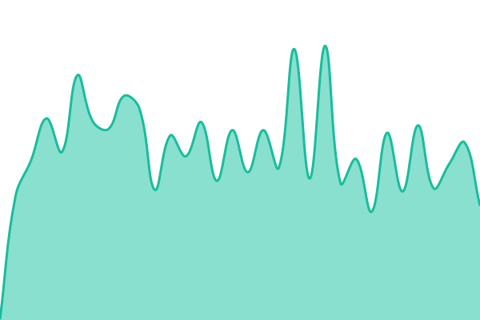
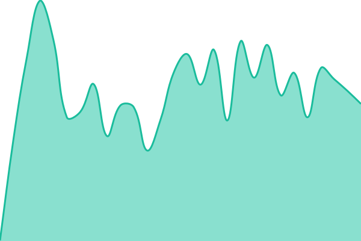
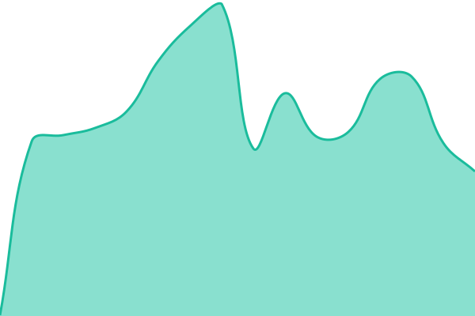
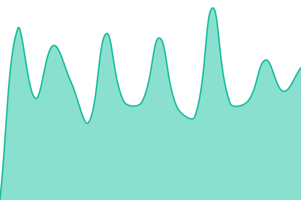

# Aeolus status

The status page of the Aeolus fleet, at [status.aeolus-fleet.dev](https://status.aeolus-fleet.dev). It runs [Upptime](https://upptime.js.org) on GitHub Actions and GitHub Pages, outside production, so it still answers when the fleet does not.

## The checks

`.upptimerc.yml` lists them, each a public URL, checked every 5 minutes by `Uptime CI`. The rows named for a check of `checks/` read that check's status issue (open when it is down or degraded) instead of a URL of the part, so the page shows what the check found; `checks/` runs them and opens and closes the issues. The fleet read check calls the fleet as a read-only probe ship, its crew token kept in the Actions secret `FLEET_PROBE_TOKEN`.

The signed-in probe uses the Actions secrets `PROBE_MAIL_ADDRESS` and `PROBE_MAIL_PASSWORD`. When its email belongs to several organisations, set the repository variable `PROBE_ORGANISATION` to the exact name of the organisation containing the probe fleet. The check chooses that organisation and verifies the protected account home or the authenticated terms page; a missing choice configuration is not reported as a product outage. When the probe must accept terms, mail sign-in can pass, while dependent page checks remain not checked until that setup is complete. The console check opens the console directly in the signed-in session, using the fleet access granted to the probe; a probe with no openable fleet is not checked. An app handoff back to the authenticated Account home with an empty fleet list or no-fleet state is not checked: the probe has no openable fleet, and its access is an owner decision. Browser app sign-in may advance automatically; the check uses Continue only when it remains offered and enabled.

## Incidents

Each incident is an issue of this repository with the label `status`, its comments the updates. A failed check opens one by itself and closes it when the check passes again. Open one by hand, with the Incident issue template, for what the checks do not see; close it when it is resolved. Issues are assigned to ThomasHendrickx, so GitHub notifies him.

## Pinned

Every action is pinned to a commit, its version beside it; the runner image and Node.js to a version. The status page package is pinned by version and checksum in `site.yml`, its dependencies by `site/package-lock.json`. No workflow regenerates the workflows: change them by hand.

<!--start: status pages-->
<!-- This summary is generated by Upptime (https://github.com/upptime/upptime) -->
<!-- Do not edit this manually, your changes will be overwritten -->
<!-- prettier-ignore -->
| URL | Status | History | Response Time | Uptime |
| --- | ------ | ------- | ------------- | ------ |
|  [Fleet](https://fleet.aeolus-fleet.dev/health) | 🟩 Up | [fleet.yml](https://github.com/ThomasHendrickx/aeolus-status/commits/HEAD/history/fleet.yml) | 

 562ms
     
 | 

<a href="https://status.aeolus-fleet.dev/history/fleet">100.00%</a>
    

|  [Fleet versions](https://fleet.aeolus-fleet.dev/version) | 🟩 Up | [fleet-versions.yml](https://github.com/ThomasHendrickx/aeolus-status/commits/HEAD/history/fleet-versions.yml) | 

 498ms
     
 | 

<a href="https://status.aeolus-fleet.dev/history/fleet-versions">100.00%</a>
    

|  [Account](https://account.aeolus-fleet.dev/sign-in) | 🟩 Up | [account.yml](https://github.com/ThomasHendrickx/aeolus-status/commits/HEAD/history/account.yml) | 

 723ms
     
 | 

<a href="https://status.aeolus-fleet.dev/history/account">100.00%</a>
    

|  [Gateway](https://gateway.aeolus-fleet.dev/api/health) | 🟩 Up | [gateway.yml](https://github.com/ThomasHendrickx/aeolus-status/commits/HEAD/history/gateway.yml) | 

 535ms
     
 | 

<a href="https://status.aeolus-fleet.dev/history/gateway">100.00%</a>
    

|  [Aeolus app](https://app.aeolus-fleet.dev/health) | 🟩 Up | [aeolus-app.yml](https://github.com/ThomasHendrickx/aeolus-status/commits/HEAD/history/aeolus-app.yml) | 

 509ms
     
 | 

<a href="https://status.aeolus-fleet.dev/history/aeolus-app">100.00%</a>
    

|  [Site](https://aeolus-fleet.dev) | 🟩 Up | [site.yml](https://github.com/ThomasHendrickx/aeolus-status/commits/HEAD/history/site.yml) | 

 900ms
     
 | 

<a href="https://status.aeolus-fleet.dev/history/site">100.00%</a>
    

|  [Site (.com)](https://aeolus-fleet.com) | 🟩 Up | [site-com.yml](https://github.com/ThomasHendrickx/aeolus-status/commits/HEAD/history/site-com.yml) | 

 834ms
     
 | 

<a href="https://status.aeolus-fleet.dev/history/site-com">100.00%</a>
    

|  [Fleet core: fleet list](https://api.github.com/repos/ThomasHendrickx/aeolus-status/issues?labels=status,check-fleet-list&state=open) | 🟩 Up | [check-fleet-list.yml](https://github.com/ThomasHendrickx/aeolus-status/commits/HEAD/history/check-fleet-list.yml) | 

 243ms
     
 | 

<a href="https://status.aeolus-fleet.dev/history/check-fleet-list">100.00%</a>
    

|  [Fleet core: message round trip](https://api.github.com/repos/ThomasHendrickx/aeolus-status/issues?labels=status,check-fleet-round-trip&state=open) | 🟩 Up | [check-fleet-round-trip.yml](https://github.com/ThomasHendrickx/aeolus-status/commits/HEAD/history/check-fleet-round-trip.yml) | 

 320ms
     
 | 

<a href="https://status.aeolus-fleet.dev/history/check-fleet-round-trip">97.08%</a>
    

|  [Trierarch plugin and trierarchs](https://api.github.com/repos/ThomasHendrickx/aeolus-status/issues?labels=status,check-trierarchs&state=open) | 🟩 Up | [check-trierarchs.yml](https://github.com/ThomasHendrickx/aeolus-status/commits/HEAD/history/check-trierarchs.yml) | 

 264ms
     
 | 

<a href="https://status.aeolus-fleet.dev/history/check-trierarchs">100.00%</a>
    

|  [squadrons](https://api.github.com/repos/ThomasHendrickx/aeolus-status/issues?labels=status,check-squadrons&state=open) | 🟩 Up | [check-squadrons.yml](https://github.com/ThomasHendrickx/aeolus-status/commits/HEAD/history/check-squadrons.yml) | 

 250ms
     
 | 

<a href="https://status.aeolus-fleet.dev/history/check-squadrons">99.29%</a>
    

|  [Gateway: OAuth discovery and MCP endpoint](https://api.github.com/repos/ThomasHendrickx/aeolus-status/issues?labels=status,check-gateway&state=open) | 🟩 Up | [check-gateway.yml](https://github.com/ThomasHendrickx/aeolus-status/commits/HEAD/history/check-gateway.yml) | 

 248ms
     
 | 

<a href="https://status.aeolus-fleet.dev/history/check-gateway">100.00%</a>
    

|  [Account: sign-in page](https://api.github.com/repos/ThomasHendrickx/aeolus-status/issues?labels=status,check-account-page&state=open) | 🟩 Up | [check-account-page.yml](https://github.com/ThomasHendrickx/aeolus-status/commits/HEAD/history/check-account-page.yml) | 

 254ms
     
 | 

<a href="https://status.aeolus-fleet.dev/history/check-account-page">99.30%</a>
    

|  [Site (.dev) in a browser](https://api.github.com/repos/ThomasHendrickx/aeolus-status/issues?labels=status,check-site-dev&state=open) | 🟩 Up | [check-site-dev.yml](https://github.com/ThomasHendrickx/aeolus-status/commits/HEAD/history/check-site-dev.yml) | 

 246ms
     
 | 

<a href="https://status.aeolus-fleet.dev/history/check-site-dev">100.00%</a>
    

|  [Site (.com) in a browser](https://api.github.com/repos/ThomasHendrickx/aeolus-status/issues?labels=status,check-site-com&state=open) | 🟩 Up | [check-site-com.yml](https://github.com/ThomasHendrickx/aeolus-status/commits/HEAD/history/check-site-com.yml) | 

 249ms
     
 | 

<a href="https://status.aeolus-fleet.dev/history/check-site-com">100.00%</a>
    

|  [Account: sign-in by mail](https://api.github.com/repos/ThomasHendrickx/aeolus-status/issues?labels=status,check-account-sign-in&state=open) | 🟩 Up | [check-account-sign-in.yml](https://github.com/ThomasHendrickx/aeolus-status/commits/HEAD/history/check-account-sign-in.yml) | 

 272ms
     
 | 

<a href="https://status.aeolus-fleet.dev/history/check-account-sign-in">99.36%</a>
    

|  [Console: signed-in overview](https://api.github.com/repos/ThomasHendrickx/aeolus-status/issues?labels=status,check-console&state=open) | 🟩 Up | [check-console.yml](https://github.com/ThomasHendrickx/aeolus-status/commits/HEAD/history/check-console.yml) | 

 267ms
     
 | 

<a href="https://status.aeolus-fleet.dev/history/check-console">95.88%</a>
    

|  [Bridge: signed-in first page](https://api.github.com/repos/ThomasHendrickx/aeolus-status/issues?labels=status,check-bridge&state=open) | 🟩 Up | [check-bridge.yml](https://github.com/ThomasHendrickx/aeolus-status/commits/HEAD/history/check-bridge.yml) | 

 272ms
     
 | 

<a href="https://status.aeolus-fleet.dev/history/check-bridge">96.36%</a>
    

|  [Aeolus app: signed-in pages](https://api.github.com/repos/ThomasHendrickx/aeolus-status/issues?labels=status,check-app&state=open) | 🟩 Up | [check-app.yml](https://github.com/ThomasHendrickx/aeolus-status/commits/HEAD/history/check-app.yml) | 

 301ms
     
 | 

<a href="https://status.aeolus-fleet.dev/history/check-app">99.03%</a>
    

<!--end: status pages-->
